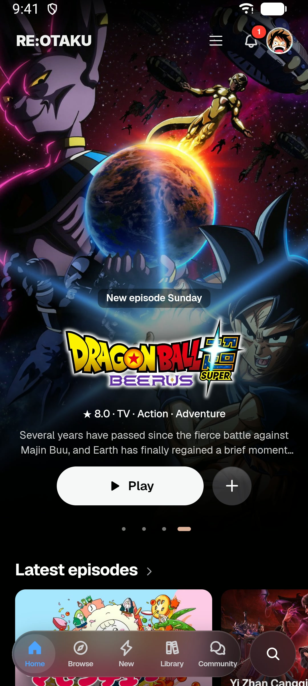
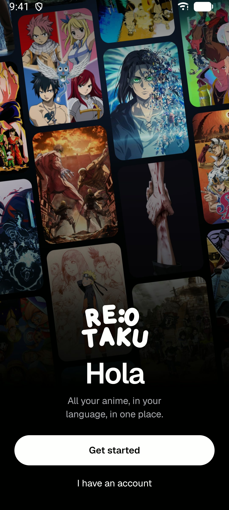
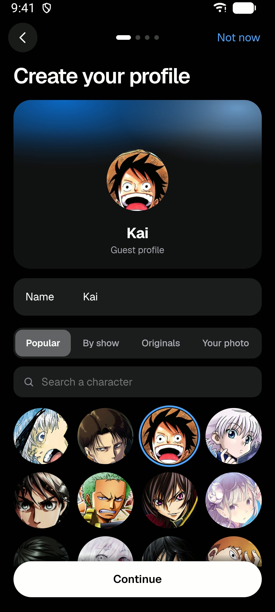
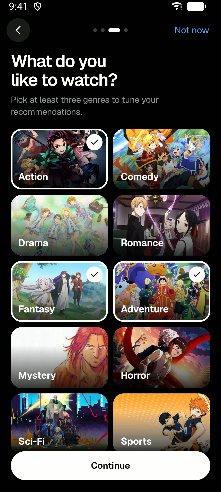
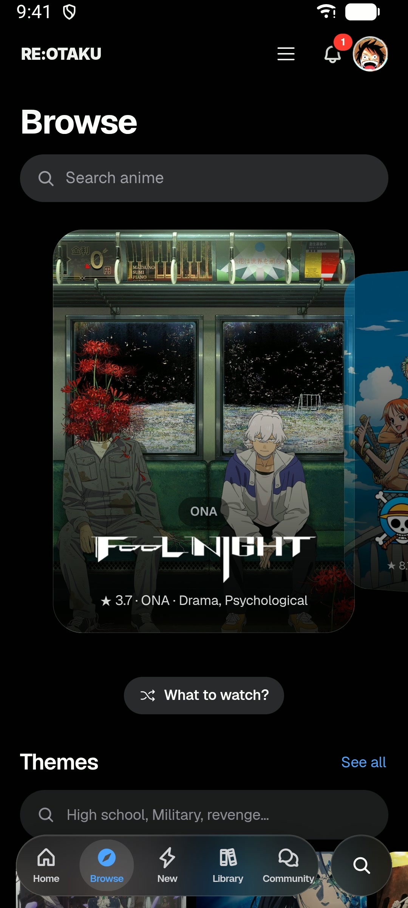
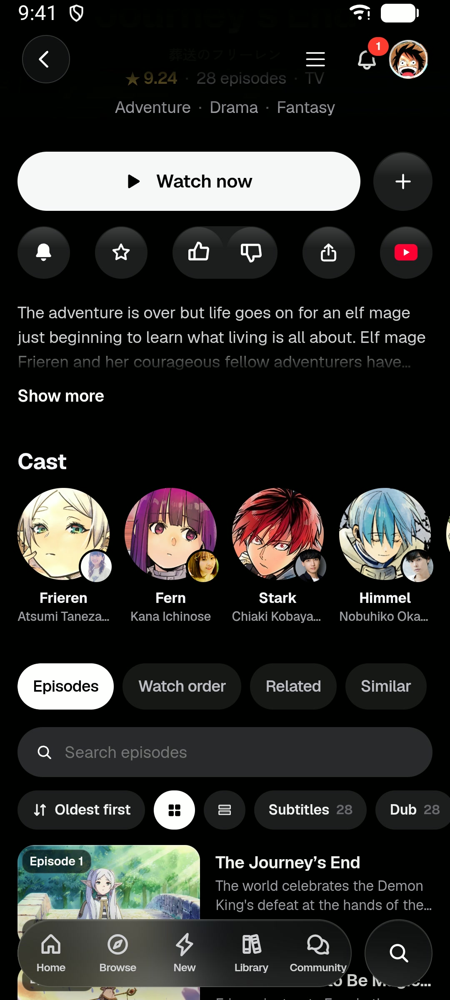
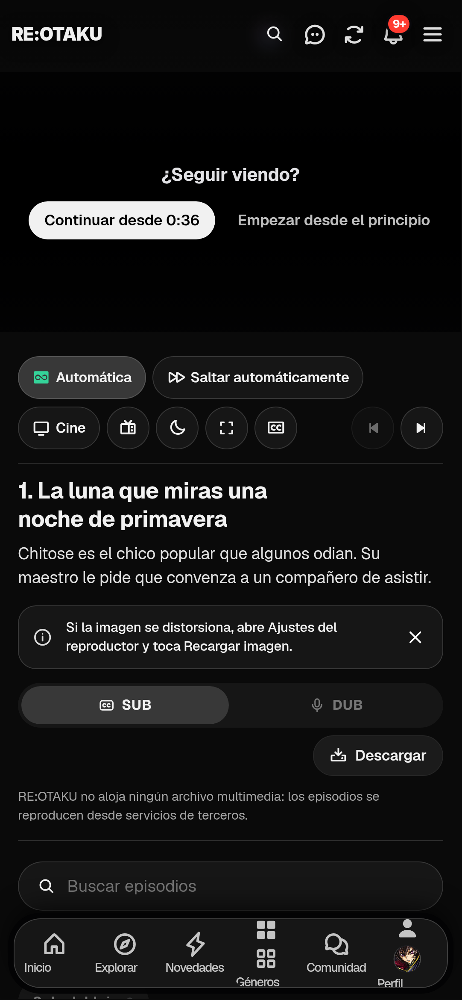
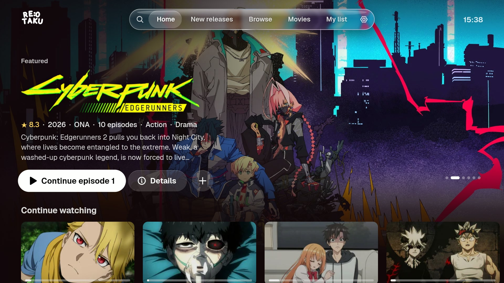
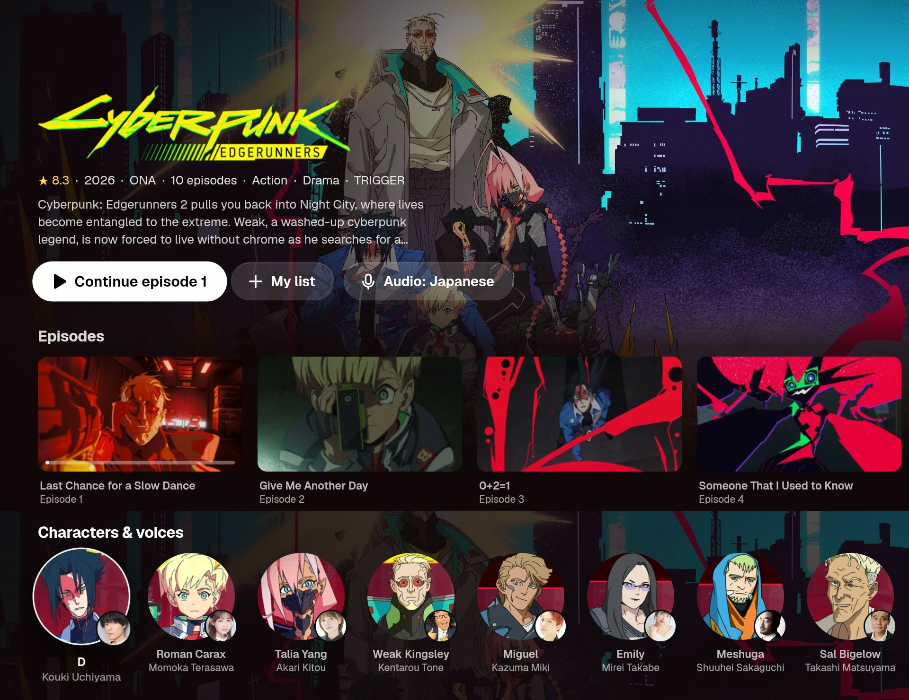

# RE:OTAKU

<p align="center">
  <strong>All your anime. In your language. In one place.</strong><br>
  A performance-focused anime app for Android and Android TV — built around fast discovery, personalisation and a plug-and-play viewing experience.
</p>

<p align="center">
  <a href="https://reotaku-descargar.vercel.app/">Official download</a> ·
  <a href="https://github.com/greenman9909-cmd/Re-Otaku/releases/latest">Latest release</a> ·
  <a href="https://github.com/greenman9909-cmd/Re-Otaku/issues">Report an issue</a>
</p>

<p align="center">
  
</p>

**Latest public release: [v2.4.2](https://github.com/greenman9909-cmd/Re-Otaku/releases/tag/v2.4.2)**

RE:OTAKU brings anime discovery, personalised profiles, an integrated HLS player, subtitle tools, a personal library and community features into one Android experience. The goal is simple: open the app, find something worth watching and press play — without having to assemble a collection of separate websites, players and tools.

---

## Screenshots

These are captures from the app, not concept mock-ups.

<p align="center">
  
  
  
</p>
<p align="center">
  
  
  
</p>
<p align="center">
  
  
</p>
<p align="center">
  
</p>

---

## What makes RE:OTAKU different

### A real app experience, not a remote website in an app-shaped box

The Android build packages its interface inside the APK and serves it from an app-local origin. The screen layout, navigation and core interface assets are already on the device when the app opens; the app does not need to download the public website just to draw its first screen.

The Android shell hosts the bundled interface through a local WebView renderer and connects it to native Android capabilities. Internet is still needed for catalogue data, artwork, streaming sources, account services and updates — but the interface itself is not waiting for a remote website deployment to load.

### Built for speed

RE:OTAKU is designed around reducing unnecessary work rather than relying on a “fastest app” claim or an unverified benchmark:

- A small, modular HTML/CSS/JavaScript interface instead of a large front-end framework.
- Bundled UI assets and libraries, reducing startup-time network dependencies.
- Prioritised and batched catalogue requests, with the currently viewed title receiving priority.
- Local caching for metadata and episode information, with stale data available while refreshes happen in the background.
- Episode lists loaded in manageable blocks instead of requesting every episode at once.
- Artwork loaded as it is needed, helping long browsing screens stay responsive.
- Focused Rust/WebAssembly routines for metadata matching, subtitle timing and playback calculations.

The result is an architecture intended to stay responsive on everyday Android hardware, including more modest devices.

### A focused Rust/WebAssembly engine

Rust is used where predictable, efficient data processing is useful. The Android application is **not entirely written in Rust**: the app also uses native Android code, HTML, CSS and JavaScript. The Rust component is a small specialist module compiled to WebAssembly and bundled into the Android build.

The current Rust module handles several performance-sensitive tasks:

- **Episode catalogue merging:** combines episode-title candidates from multiple metadata sources, prefers stronger matches, cleans generic labels and fills missing titles without inventing misleading names.
- **Subtitle release matching:** understands season, episode, TVDB and absolute episode numbering, and rejects filenames that point to the wrong season or episode.
- **Subtitle timeline indexing:** indexes timed cues and finds the cues active at the current playback position.
- **Subtitle alignment:** compares cue timings against a reference track and estimates a timing offset.
- **Quality selection:** chooses the highest advertised rendition within a configured quality cap, with a lower-quality fallback when needed.

The Rust crate is built for `wasm32-unknown-unknown`. Its release profile uses optimisation level 3, link-time optimisation, symbol stripping and abort-on-panic. The crate currently has no third-party Rust dependencies.

### Plug-and-play playback

- An on-device episode-source resolver and HLS relay help locate a playable source.
- The app can retry source requests and select a suitable source instead of making the user manually manage a separate player.
- Playback stays inside RE:OTAKU's player.
- Audio and subtitle track controls, including SUB/DUB where the source provides them.
- Quality selection, fullscreen playback, episode navigation and playback shortcuts.
- Automatic episode-title matching helps keep the displayed episode list useful and consistent.
- Subtitle matching and translation tools help when a provider does not supply the preferred language.

Source availability and language tracks depend on the upstream provider and the individual episode.

### Personalisation that starts with you

The first-run flow lets viewers shape the app around their preferences:

- Create a guest profile with a name and avatar.
- Choose a character image or a personal image for the profile.
- Select favourite genres to tune discovery and recommendations.
- Keep a personal list, watch history and playback progress.
- View profile activity and viewing statistics.
- Adjust language, playback, subtitle and general preferences.
- Use guest mode without having to create an account first. Optional sign-in and account-backed sync features are available where enabled.

### Discovery and catalogue

- Search and browse anime across a large catalogue.
- Explore genres, themes, trending titles and new releases.
- Open detailed title pages with artwork, synopsis, seasons and episodes.
- Browse cast and voice-actor information.
- Find related titles and recommendations.
- Combine catalogue information from services such as AniList and TMDB, with additional metadata sources used to fill gaps.
- The interface is available in seven app languages in the v2.3.1 release line.

### Android TV

RE:OTAKU also has a dedicated Android TV build and TV-oriented layouts:

- Large-screen navigation designed for a television.
- D-pad focus movement and remote-friendly controls.
- TV title pages, episode selection and browsing.
- A separate TV APK, so TV users do not have to install the phone package.

### Community

The app includes community surfaces for discussions and suggestions, plus live chat from the app interface. Availability of online community features depends on the connected service.

---

## Updates

RE:OTAKU has two update paths, depending on what changed.

1. **Interface OTA patches:** compatible CSS and JavaScript interface changes can be delivered through the app's update feed without reinstalling the APK.
2. **Full Android app updates:** the built-in updater checks the official GitHub Releases, identifies a newer compatible APK and offers the download. Native Android code, the Rust/WASM module and playback-engine changes require a new APK.

The full APK updater is user-initiated. Android controls package-install permissions and confirmation; on supported Android versions, later updates may require fewer prompts after the updater has been authorised. Updates are intended to install over the existing package with the same signing identity, preserving the app's data.

---

## Download

| Build | Download |
| --- | --- |
| Android phone | [reotaku-android.apk](https://github.com/greenman9909-cmd/Re-Otaku/releases/download/v2.3.1/reotaku-android.apk) |
| Android TV | [reotaku-tv.apk](https://github.com/greenman9909-cmd/Re-Otaku/releases/download/v2.3.1/reotaku-tv.apk) |
| Universal APK | [reotaku-universal.apk](https://github.com/greenman9909-cmd/Re-Otaku/releases/download/v2.3.1/reotaku-universal.apk) |

- [Official download website](https://reotaku-descargar.vercel.app/)
- [All GitHub releases](https://github.com/greenman9909-cmd/Re-Otaku/releases)
- [v2.3.1 release notes and SHA-256 asset](https://github.com/greenman9909-cmd/Re-Otaku/releases/tag/v2.3.1)

For the Android phone build, the v2.3.1 APK is approximately **26.3 MiB**. Choose the TV or universal package only when it matches your device.

### Verify your APK

Before installing, compare the downloaded file's SHA-256 hash with the matching entry in [`checksums.txt`](checksums.txt).

**Windows (PowerShell)**

```powershell
Get-FileHash .\reotaku-android.apk -Algorithm SHA256
```

**Linux / macOS**

```bash
sha256sum reotaku-android.apk
```

You can also verify the Android package signature with `apksigner`. A package signed with a different certificate cannot update the installed app.

---

## What this GitHub repository contains

This is the **public release and transparency repository** for RE:OTAKU. It contains:

- Published Android and Android TV releases.
- SHA-256 checksums and APK verification tools.
- Screenshots of the app.
- Release notes and documentation covering architecture, privacy, permissions and security.

The complete application engine is not published here. The production interface, source resolver and playback implementation are distributed as part of the app and remain proprietary. **This repository is public, but it is not a complete open-source project and cloning it will not build the application.** See [`docs/OPEN-SOURCE.md`](docs/OPEN-SOURCE.md) for the scope.

---

## Latest release highlights — v2.3.1

- Fixed bottom navigation label clipping.
- Added an AniList poster fallback when featured Browse artwork from TMDB is unavailable.
- Localised 404 route messages across all seven app languages.

See the [full release history](https://github.com/greenman9909-cmd/Re-Otaku/releases).

## Feedback and security

- Bugs, compatibility reports and feature ideas: [open an issue](https://github.com/greenman9909-cmd/Re-Otaku/issues).
- Security reports: **security@reotaku.com**. Please do not publish exploitable vulnerabilities in a public issue; see [`SECURITY.md`](SECURITY.md).

## License

The application and its proprietary components are **all rights reserved**. Public availability of this repository does not grant permission to redistribute the APK or reuse proprietary app content. See [`LICENSE`](LICENSE).
