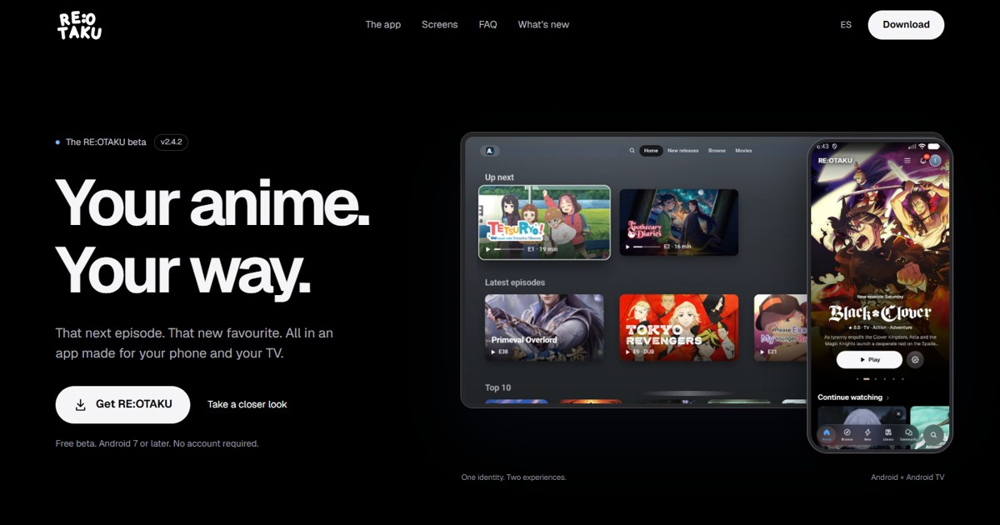
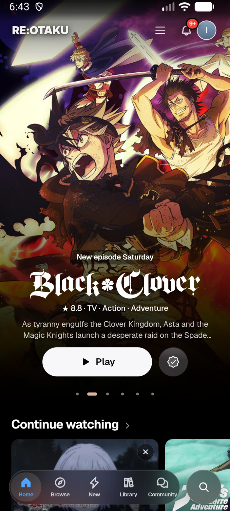
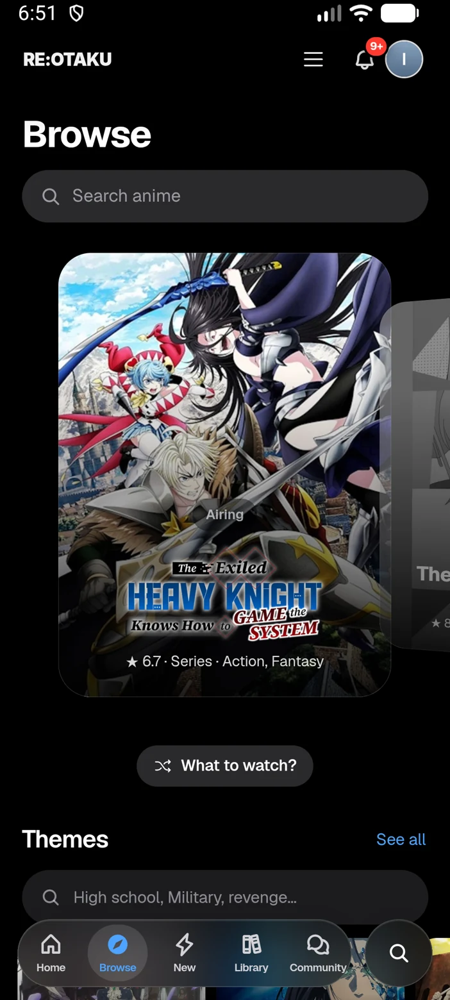
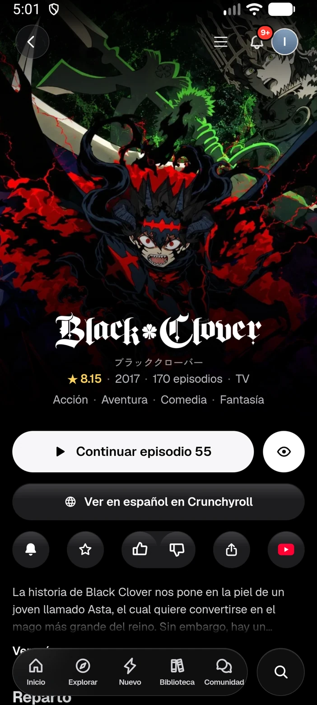
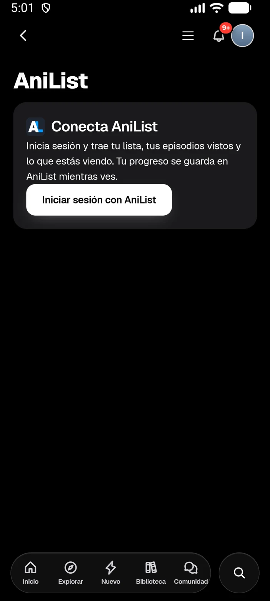
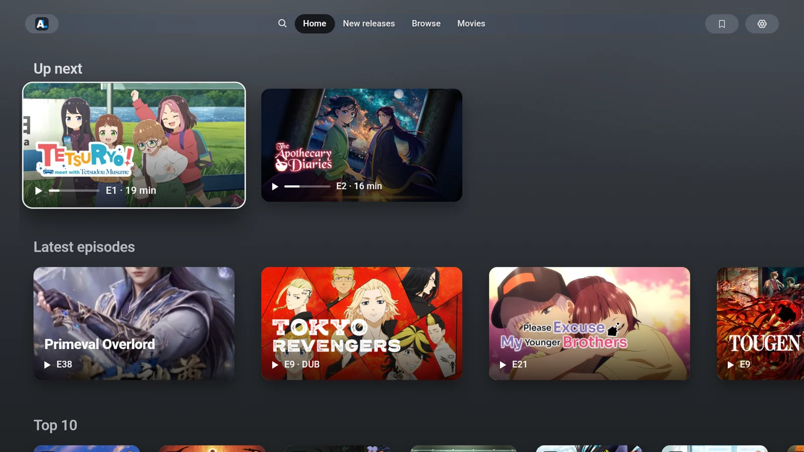
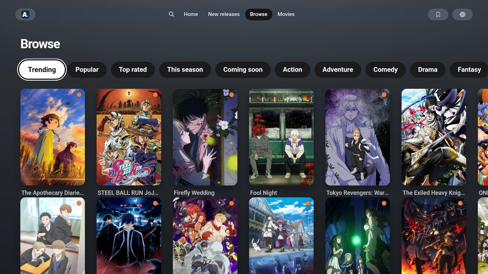
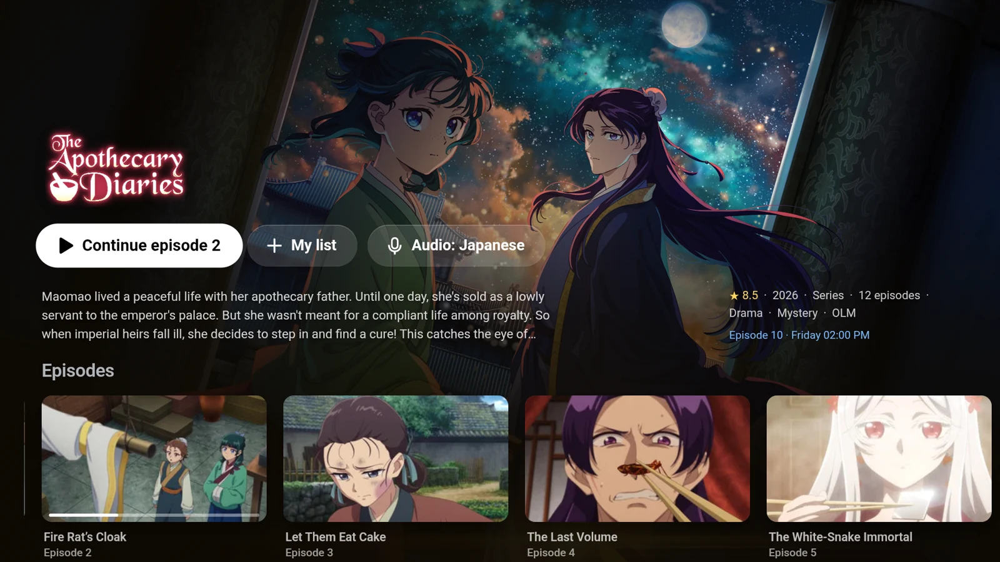

<p align="center"></p>
<h1 align="center">Your anime. Your way.</h1>
<p align="center">An anime app made for Android phones and Android TV.<br>Discover your next favourite, make it yours, and pick up where you left off.</p>
<p align="center"><a href="https://reotaku-descargar.vercel.app/"><strong>Get RE:OTAKU</strong></a> · <a href="https://github.com/greenman9909-cmd/Re-Otaku/releases/latest">Latest release</a> · <a href="https://github.com/greenman9909-cmd/Re-Otaku/issues">Report an issue</a></p>



**Current public beta: [2.4.7](https://github.com/greenman9909-cmd/Re-Otaku/releases/tag/v2.4.7)** · Android 7 or later · No account required to explore.

RE:OTAKU brings anime discovery, personal profiles, a library, an integrated player and optional AniList tracking into one experience. Android TV has its own layout and remote navigation, so the app feels at home on a larger screen.

## Get the app

| Your screen | Download | Size |
| --- | --- | --- |
| Android phone | [Android APK](https://github.com/greenman9909-cmd/Re-Otaku/releases/latest/download/reotaku-android.apk) | 26.6 MiB |
| Android TV | [TV APK](https://github.com/greenman9909-cmd/Re-Otaku/releases/latest/download/reotaku-tv.apk) | 2.2 MiB |
| Other compatible Android devices | [Universal APK](https://github.com/greenman9909-cmd/Re-Otaku/releases/latest/download/reotaku-universal.apk) | 70.8 MiB |

Sizes refer to version 2.4.7. The [download website](https://reotaku-descargar.vercel.app/) includes installation steps, screenshots, FAQs and community reviews.

On your phone, download the APK and open it. Android may ask you to allow installation from your browser or file manager. On Android TV, open the download website in Downloader and choose the TV APK. Install updates over the same package to preserve local app data.

## A closer look

Real app captures, refreshed on 27 November 2026. Home, Browse and TV captures were taken from the installed 2.4.2 builds; title and AniList captures are from the same day's app session. No concept screens are presented as released features.

<p align="center">




</p>

### Made for the living room



<p align="center">


</p>

## What you can do

- **Discover:** explore new releases, genres, recommendations and title details.
- **Personalise:** choose a profile, avatar and preferences.
- **Keep your place:** organise a library and return to your episodes.
- **Connect AniList:** sign in optionally to connect anime tracking.
- **Watch:** use the integrated player, episode controls, audio selection and subtitle tools.
- **Use your language:** choose among seven interface languages. Audio and subtitle availability depend on the title, episode and source; translations require an available service.
- **Use a remote:** navigate Android TV with directional buttons, OK and Back, with visible focus.
- **Adjust performance:** reduce visual effects on devices with fewer resources.

The small TV package is a dedicated build. Package size alone is not a performance benchmark; playback and browsing also depend on the device, Android WebView, network and source.

## Latest changes

Version 2.4.2 includes mobile player, AniList, library and update improvements. TV title logos follow the selected language. See the [release notes](https://github.com/greenman9909-cmd/Re-Otaku/releases/tag/v2.4.2) and [changelog](CHANGELOG.md).

The app checks for updates and offers compatible APKs. Android controls installation permissions and confirmations. Compatible interface patches may also arrive through the app's update feed.

## Verify a download

Compare your APK with the corresponding entry in [checksums.txt](checksums.txt), or the SHA-256 file attached to its release.

```powershell
Get-FileHash .\reotaku-android.apk -Algorithm SHA256
```

```sh
sha256sum reotaku-android.apk
```

Only compare against checksums for the version you downloaded. The project's [verification guide](docs/VERIFY.md) provides more detail.

## About this repository

This is the public release and transparency repository. It contains APK releases, checksums, screenshots, documentation, verification tools and the download website's source in [website/](website/).

The application engine, source resolver and player implementation remain proprietary. Cloning this repository does not build the Android app. Public availability does not grant rights to reuse proprietary app content; see [LICENSE](LICENSE).

RE:OTAKU does not host video files. Playback sources are third-party services, and availability can change. Titles and artwork belong to their respective owners. This product uses the TMDB API but is not endorsed or certified by TMDB.

## Feedback

For a bug, [open an issue](https://github.com/greenman9909-cmd/Re-Otaku/issues) with your device model, Android version, app version and steps to reproduce it. Keep passwords, tokens and private account details out of reports. Security reports follow [SECURITY.md](SECURITY.md).

The download website has its own [privacy information](https://reotaku-descargar.vercel.app/privacy.html), including its aggregate download counter and public reviews.
